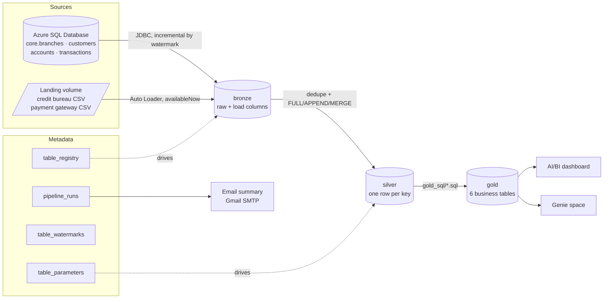

# LedgerLake · metadata-driven lakehouse for a digital bank

An end-to-end data engineering project on **Databricks Free Edition**. LedgerLake loads
core-banking data from **SQL Server** and partner files from a **landing volume**, builds
**bronze → silver → gold** layers in **Unity Catalog**, runs on **Databricks Jobs**, emails a
run summary, and serves an **AI/BI dashboard** and a **Genie** space.

The bank, Coral Digital Bank, is fictional, and all data is synthetic (generated by
`source_data/generate_data.py`).

Build log: [PROGRESS.md](PROGRESS.md) (built over 10 days, with the hands-on Databricks step for each).

> **The idea:** nothing about individual tables is hard-coded in notebooks. A registry table
> says *what* to load, a parameters table says *how* (FULL / APPEND / MERGE, keys, watermark),
> and the same four generic notebooks load every table. Adding a table is a metadata row,
> not new code.

## Architecture



### Jobs

```
ll_master                               (one run_id for the whole run, scheduled 06:30 Sydney, paused)
 ├─ ingest_sqlserver → ll_source_ingest(source_system=sqlserver)
 │                       list_tables → for each table → ll_table_ingest
 │                                                        read_table_parameters → source_to_bronze → bronze_to_silver
 ├─ ingest_files     → ll_source_ingest(source_system=files)
 ├─ build_gold       → ll_gold: list_tables(silver) → for each → build_gold_table
 └─ send_run_summary   (run if: all done, so failures get reported too)
```

### Metadata tables (`ledgerlake.metadata`)

| Table | Purpose |
|---|---|
| `table_registry` | One row per table: source system, source object, target layer, load order, active flag |
| `table_parameters` | Key/value settings per table: `load_type`, `primary_key`, `watermark_column`, `file_format`, `schema_hints` |
| `table_watermarks` | `source_watermark` (how far SQL Server has been read) and `bronze_watermark` (how far bronze has been merged into silver) |
| `pipeline_runs` | Append-only audit log: one row per table, per layer, per run, with rows processed and errors |

### Tables loaded

| Table | Source | Load type | Key | Watermark |
|---|---|---|---|---|
| branches | SQL Server | FULL | branch_id | (none) |
| customers | SQL Server | MERGE | customer_id | updated_at |
| accounts | SQL Server | MERGE | account_id | updated_at |
| transactions | SQL Server | APPEND | transaction_id | txn_timestamp |
| credit_bureau_reports | CSV files | MERGE | customer_id | pulled_at |
| payment_gateway_events | CSV files | APPEND | event_id | event_timestamp |

### Gold tables

| Table | Grain | What it answers |
|---|---|---|
| `customer_360` | customer | Products held, deposits, lending, 90-day activity, latest credit score, value segment, dormancy |
| `branch_scorecard` | branch | Customers, growth, deposits, lending, loan-to-deposit ratio, credit quality, rank |
| `channel_daily_summary` | Sydney date × channel × direction | Volumes, values, decline rates |
| `bank_daily_kpis` | Sydney date | Transactions, active customers, inflows/outflows, card spend, declines, gateway fees and latency |
| `credit_risk_watchlist` | customer with ≥1 risk signal | Risk points, review priority and plain-English reasons |
| `payment_gateway_daily` | Sydney date × gateway | Settled/declined/reversed, p50/p95 latency, fees, data-quality counts |

## Repo layout

```
databricks.yml, resources/jobs.yml   Asset Bundle: the four jobs as code
setup/00_create_catalog_and_metadata.py   catalog, schemas, volume, metadata tables + seed
setup/01_create_secrets.py                SQL Server + Gmail secrets (Databricks SDK)
notebooks/ingestion/01..04                list tables, read parameters, source→bronze, bronze→silver
notebooks/gold/01_build_gold_table.py     runs one gold_sql file
notebooks/notify/01_send_run_summary.py   HTML email from pipeline_runs
notebooks/admin/check_pipeline.py         runs, watermarks, row counts, rescued rows
src/ledgerlake/                           the framework (metadata, bronze, silver, gold, notify)
gold_sql/*.sql                            one SELECT per gold table
source_data/                              data generator, SQL Server DDL, loader
dashboards/                               dashboard datasets + Genie space setup
tests/                                    pytest (runs locally on Spark, no Databricks needed)
```

---

## Set it up (about 2 hours the first time)

### 1. Accounts you need
- **Databricks Free Edition** (free, permanent; non-commercial use only).
- **Azure account** for an **Azure SQL Database free offer** database: 100,000 vCore seconds
  and 32 GB per month, for the life of the subscription. Choose *auto-pause* when the limit is
  reached so it can never bill you.
- **Gmail app password** (optional, for the summary email): Google Account → Security →
  2-Step Verification → App passwords.

### 2. Generate the data (on your PC)
```bash
cd source_data
python generate_data.py --out generated
```
Default size: 1,500 customers, about 2,300 accounts, about 366,000 transactions and 203,000
gateway events in batch 01, plus a one-week incremental batch 02. Use `--customers` to scale it.

### 3. Create and load the SQL Server source
1. Azure portal → *Azure SQL* → **Create a database** → *Start free*. Database name `coralbank`,
   SQL authentication (note the admin user and password).
2. Server → *Networking*: add your PC's IP. Databricks serverless has no fixed outbound IP, so
   also add a rule `0.0.0.0 – 255.255.255.255` for the demo (the data is fake; use a strong
   password, and remove the rule when you're done).
3. Load batch 01 (needs `pip install pyodbc` and *ODBC Driver 18 for SQL Server*):
   ```bash
   set LL_SQL_SERVER=<server>.database.windows.net
   set LL_SQL_DATABASE=coralbank
   set LL_SQL_USER=<admin user>
   set LL_SQL_PASSWORD=<password>
   python load_sqlserver.py --init generated/sqlserver/batch_01_historical
   ```

### 4. Get the code into Databricks
Push this repo to GitHub, then in Databricks: **Workspace → Create → Git folder** → paste the
repo URL. (Notebooks find `src/` by relative path, so keep the folder structure.)

### 5. Run the setup notebooks
1. `setup/00_create_catalog_and_metadata`: creates `ledgerlake` + schemas + volume + metadata.
   If creating a catalog isn't allowed, set the widget to `workspace` and pass
   `catalog=workspace` to the jobs.
2. `setup/01_create_secrets`: fill in the widgets, run, then **remove the widgets and clear
   outputs**. The last cell tests the SQL Server connection.

   CLI alternative:
   ```bash
   databricks secrets create-scope ledgerlake
   databricks secrets put-secret ledgerlake sqlserver-connection --string-value '{"host":"<server>.database.windows.net","port":1433,"database":"coralbank","user":"<user>","password":"<password>"}'
   databricks secrets put-secret ledgerlake gmail-app-password --string-value '<16-char app password>'
   ```

### 6. Upload batch 01 files to the landing volume
Catalog Explorer → `ledgerlake` → `source` → `landing` → upload
`credit_bureau_reports_batch_01.csv` into `credit_bureau_reports/` and
`payment_gateway_events_batch_01.csv` into `payment_gateway_events/`.
(CLI: `databricks fs cp <file> dbfs:/Volumes/ledgerlake/source/landing/<folder>/`)

### 7. Create the jobs
**Option A, Asset Bundle (recommended):** install the Databricks CLI, `databricks auth login`,
then from the repo root:
```bash
databricks bundle deploy --var="summary_recipients=you@example.com" --var="gmail_sender=you@gmail.com"
```
**Option B, UI:** create the four jobs by hand in *Jobs & Pipelines*, matching
`resources/jobs.yml`: same task names, notebook paths, job parameters and the For-each
inputs `{{tasks.list_tables.values.tables}}` with `{{input}}` passed as `table_metadata`.

### 8. Run it
Run **ll_master**. Then open `notebooks/admin/check_pipeline` to see the audit rows, the
watermarks, row counts per layer, and the three gateway rows whose `latency_ms` was `timeout`
(kept in `_rescued_data`).

### 9. Prove the incremental load
```bash
python load_sqlserver.py generated/sqlserver/batch_02_incremental
```
Upload the two `*_batch_02.csv` files to the same landing folders and run **ll_master** again.
Check that:
- only the new and changed rows were read from SQL Server (`rows_processed` for bronze),
- customers pulled twice by the credit bureau appear once in silver (the latest pull),
- the repeated gateway events weren't double counted,
- running ll_master a third time with no new data loads 0 rows and changes nothing.

### 10. Dashboard and Genie
- Dashboard: create the datasets in `dashboards/dashboard_queries.sql` and the widgets listed
  under each one. Publish it and share it in **Databricks One**.
- Genie: follow `dashboards/genie_space.md`.

---

## Design decisions

| Decision | Why |
|---|---|
| Registry + parameters tables drive every load | New tables need metadata, not code; the four notebooks stay generic |
| Two watermarks per table | `source_watermark` controls what is extracted from SQL Server; `bronze_watermark` (`_ingested_at`) controls what moves to silver, so a late file with old business timestamps is still processed |
| Source watermark moves after the bronze write, bronze watermark after the silver write | A failure at either step re-processes only that step's data next run |
| De-duplicate to the latest row per key before writing silver | Two versions of a key in one batch would make Delta MERGE fail |
| APPEND is an insert-only MERGE on the key | Re-running a failed run can't duplicate transactions or events |
| MERGE only updates when the incoming row is newer | An out-of-order replay can't overwrite newer data |
| `pipeline_runs` is append-only | Parallel tasks never conflict on the audit table; the email takes the latest attempt per table |
| Auto Loader with `schemaHints` | Key columns get fixed types; values that don't fit go to `_rescued_data` instead of failing the load or silently becoming strings |
| Gold tables are plain SELECT files rebuilt with CREATE OR REPLACE | Easy to review and test; re-running is always safe |
| Daily gold tables use Sydney dates | Source timestamps are UTC; a bank's "day" is a local day |
| Secrets via the Databricks SDK or CLI | No tokens copied into or printed by notebooks |
| Table and column names are validated before going into SQL text | Metadata is data; it shouldn't be able to inject SQL |

## Tests
```bash
pip install -r requirements-dev.txt     # pyspark, pytest (needs Java 17+)
pytest -q
```
42 tests cover the data generator, config validation, SQL-injection guards, watermark
slicing, de-duplication, every gold SQL file and every dashboard query on local Spark. The
Delta-specific steps (MERGE, CREATE OR REPLACE) and Auto Loader only run on Databricks, so
verify those with step 9.

## Known limitations
- `>` on second-precision watermarks can miss a row committed in the same second as the last
  extracted row. A production version would extract with a small overlap and rely on MERGE.
- Free Edition limits outbound internet to trusted domains. If the JDBC test in
  `setup/01_create_secrets` times out, the workspace can't reach your Azure SQL server.
- Ingestion runs one table at a time to stay inside Free Edition's 5 concurrent task limit.

## Credits
The architecture (metadata-driven ingestion from SQL Server and files, Databricks Jobs
with For-each, email summary, AI/BI dashboard and Genie) follows DataBeli's tutorial
*Finance Domain End-to-End Data Engineering Project in Databricks (Free Edition)*. The code,
data model, data generator, gold logic and tests in this repo were written from scratch.
